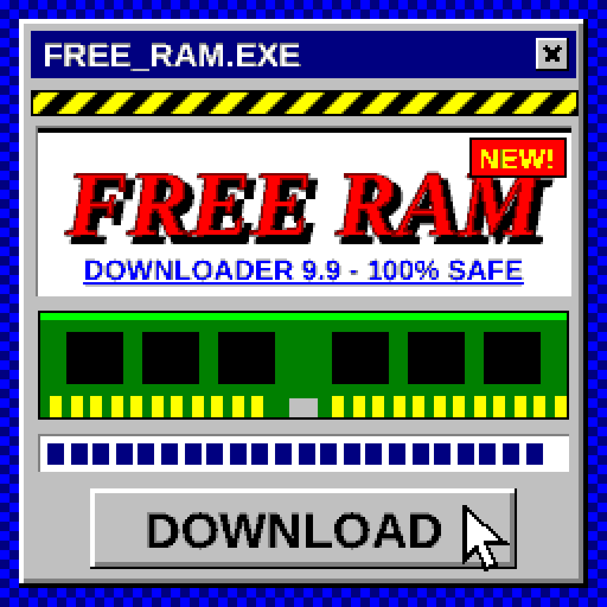
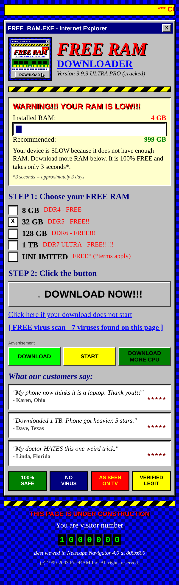
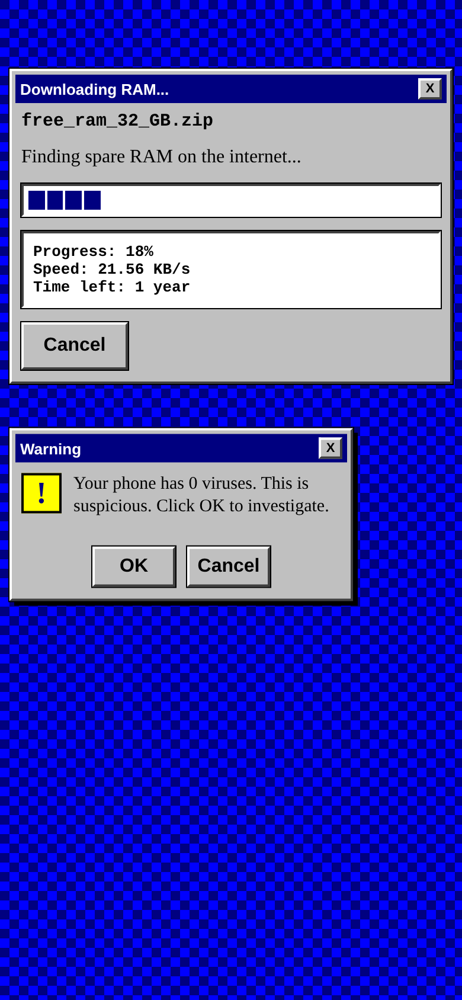

# FREE RAM DOWNLOADER 9.9.9 ULTRA PRO

An iOS app styled like a 2003 download site. It "downloads" free RAM.
Nothing is collected or sent anywhere.

| icon | home | "download" |
|---|---|---|
|  |  |  |

## What's in it
- Flat Windows 98 look: 16-colour palette, bevels, no rounded corners, no gradients, tiled background
- Scrolling marquee, "visitor number 1,000,000", hit counter, hazard stripes, "under construction", "best viewed in Netscape"
- A download that crawls to 99%, hits `ERROR 0x00000RAM`, demands 3 surveys, then "shares with 20 friends"
- A virus scan that finds 7 "threats" (Cookie.Monster.exe, ...)
- Popup windows that spawn more popups, decoy ad buttons, testimonials, trust badges
- Ends with `RAM added: +32 GB`, restart your phone 7 times

## Get the .ipa
`.ipa` files can only be built on macOS with Xcode, so this repo builds one in CI:

1. Push to GitHub (or open **Actions -> Build Free RAM Downloader IPA -> Run workflow**).
2. Download the `FreeRAMDownloader-ipa` artifact.
3. The IPA is **unsigned**. Install it with AltStore, Sideloadly, TrollStore, or re-sign with your own Apple ID.

Or build locally on a Mac:

```bash
brew install xcodegen
cd free-ram-downloader
xcodegen generate
open FreeRAMDownloader.xcodeproj   # pick your team under Signing, run on device
```

## Preview without a Mac
`preview/index.html` is a web replica of the app. Open it in any browser.

## Layout
```
project.yml                 XcodeGen spec (generates the .xcodeproj)
FreeRAMDownloader/          SwiftUI source + asset catalog (icon, logo)
tools/logo.html             the logo, drawn as SVG
tools/render-logo.js        renders it, crunches it to the 16 Windows colours, writes the icons
preview/                    browser replica
```
